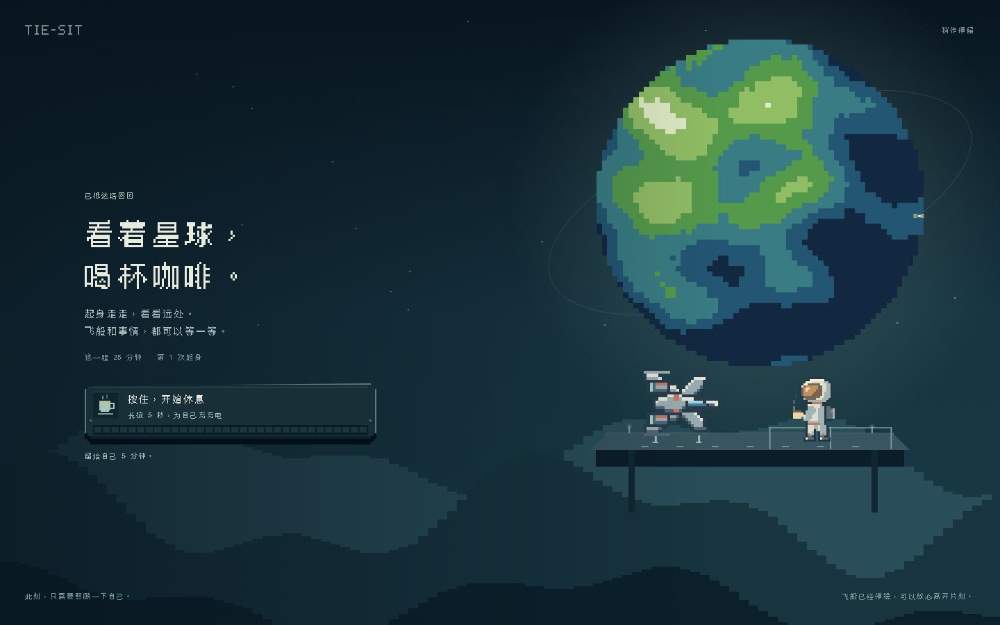
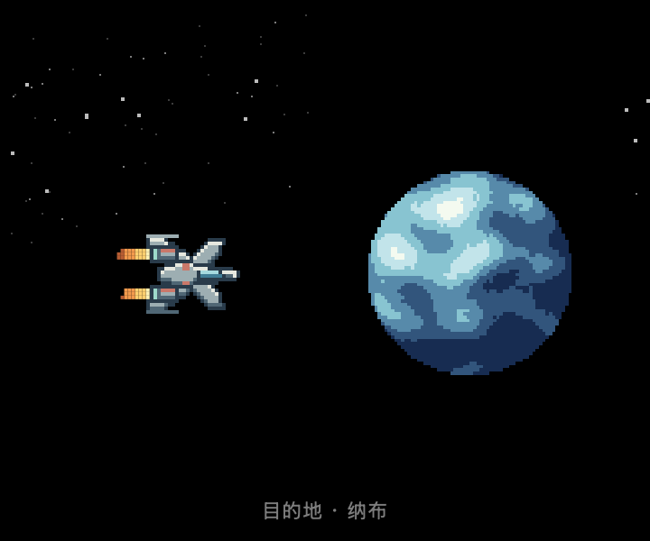
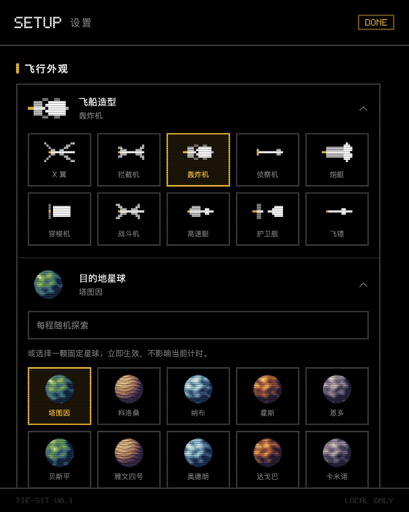

# 起立令 TIE-SIT

macOS 菜单栏久坐提醒。到达阈值后显示全屏提醒，长按充能即可开始休息。

## 产品预览



| 驾驶舱飞行动效 | 飞船与星球设置 |
| --- | --- |
|  |  |

## 支持的功能

- **菜单栏久坐计时**：查看剩余时间和本次久坐进度，提醒阈值可选 25、45、60 或 90 分钟。
- **全屏休息提醒**：到时在所有显示器上提示起身。按住按钮 3、5 或 8 秒，充能完成后进入休息。
- **休息倒计时**：休息时长可设为 0、2、5 或 10 分钟。休息期间暂停累计久坐时间，倒计时结束后开始下一程。
- **像素飞行与观景**：可选 10 种飞船、50 颗星球，支持固定目的地或每程随机探索。休息时飞船停泊，宇航员在观景台举杯。
- **历史统计与导出**：查看当天久坐区间、近 30 天热力图和全年趋势，以及起身次数、最长连续久坐和达标天数。记录保存在本机，可导出 JSON。
- **偏好设置**：可调整开机启动、音效、CRT 扫描线、场景动效、每日统计起点和下班提醒。

## 怎么装

需要 macOS 13 或更新版本。

Apple Silicon Mac 可以从 [GitHub Releases](https://github.com/Honeylemonade/tie-sit/releases/latest) 下载 `TIE-SIT-macOS-arm64.zip`。解压后将 `TIE-SIT.app` 拖到「应用程序」并打开。安装包使用临时签名，未经 Apple 公证。如果 macOS 阻止打开，可在「系统设置 → 隐私与安全性」中选择「仍要打开」。

### 从源码构建

**第一步**，装编译工具（只需一次）。打开「终端」，粘贴：

```
xcode-select --install
```

弹出窗口点「安装」，等它下完（1-2GB，几分钟）。如果已经装过会直接提示已安装。

**第二步**，进入这个文件夹，跑构建脚本：

```
cd 到这个文件夹
chmod +x build.sh
./build.sh --install
```

它会编译、打包、装到 `/Applications`，然后启动。菜单栏右上角出现一个 TIE 战机图标，旁边跟着倒计时。

第一次打开如果系统提示「无法验证开发者」，在「系统设置 → 隐私与安全性」页面底部点「仍要打开」。这个脚本已经清掉了隔离属性，多数情况下不会弹。

## 怎么用

点菜单栏图标弹出驾驶舱。中间是随机目的地星球，飞船随进度慢慢逼近；下方血条是本次在座进度。

**点右上角的 `◉ 45M`** 直接切阈值：25 / 45 / 60 / 90 分钟，不用进设置。

到时间后屏幕被接管。按住「开始休息」，等能量格充满后进入休息。长按时长可在设置中选 3、5 或 8 秒。中途松手会清零，得重来。

解锁后进入 5 分钟休息倒计时，这段时间在座时间不累积。这是刻意的——否则你按完坐回去，软件就退化成「每 45 分钟让你点一次屏幕」。

底部三个按钮：`STATS` 统计、`SETUP` 设置、`QUIT` 退出。

## 统计

三个尺度，各回答一个问题：

- **今天** — 在座分段条，一眼看出哪几段坐太久
- **近 30 天** — 日历热力网格，最近节奏有没有变坏
- **近 365 天** — 52 周柱状图 + 全年网格，一年里最低谷是哪几周

绿色是达标，红色是超标，中间没有黄色缓冲。四个核心指标：今日起身次数、最长连续、连续达标天数（连击）、近 7 天日均在座。

「连续达标天数」断了会掉回 1，所以别断。

## 数据

存在 `~/Library/Application Support/TIESit/data.json`，纯本地，不联网、不上传、无账号、无埋点。

统计页底部可以导出 JSON 备份，也可以直接在 Finder 里打开那个文件夹。

## 关于「关不掉」

警报窗口没有关闭按钮，ESC、空格、回车、Cmd+W、Cmd+Q 全部被吞掉。窗口层级是 `.screenSaver`，压得住全屏浏览器和视频；多显示器一起锁；切到别的 Space 也跟着。

**但强制退出（Cmd+Option+Esc 或活动监视器）仍然可行。** 这是 macOS 留给用户的最终保险，任何 App 都绕不过，也不该试图绕。

## 设置项

- 触发阈值 25 / 45 / 60 / 90 分钟
- 休息时长 0 / 2 / 5 / 10 分钟
- 长按要求 3 / 5 / 8 秒
- 开机自动启动（默认开）
- 8-bit 音效（静音只影响音效，不影响警报）
- CRT 扫描线（嫌花可以关）
- 强制下班（连续 10 小时触发不可提前解除的警报，默认关）
- 一天从几点切分（熬夜的人建议改成凌晨 4 点）

## 没有 Xcode 怎么办

`build.sh` 只需要 Command Line Tools（`xcode-select --install`），不需要完整的 Xcode，也不需要 Apple 开发者账号。

如果 `./build.sh` 报错，把终端里的完整输出发我。

## 项目结构

```
TIESit/
├── build.sh                    一键构建
├── Package.swift               Swift Package 描述（也能用 swift build）
├── Resources/
│   └── Info.plist              LSUIElement=true，不进 Dock
└── Sources/TIESit/
    ├── TIESitApp.swift         入口、菜单栏、窗口调度
    ├── SitEngine.swift         状态机、计时、数据模型
    ├── Theme.swift             九色调色板、5×7 点阵字库、通用件
    ├── CockpitView.swift       驾驶舱
    ├── AlertView.swift         全屏警报 + 长按
    ├── AlertWindow.swift       遮罩窗口、事件拦截
    ├── StatsView.swift         三个尺度的统计
    ├── SettingsView.swift      设置
    ├── Audio.swift             方波合成音效、空闲检测
    └── LoginItem.swift         开机自启
```

零第三方依赖。

## 修复与验证（2026-11-10）

- 星球改为代码生成的 50 张透明像素纹理，不再把生成器截图当素材。
- 飞船在整个航程内完整可见，场景适配实际可用高度，动画以 30 FPS 刷新。
- 长按中途松开或拖出按钮会清零，解除回调避免重复执行。
- 每 30 秒保存当前计时，正常退出时保存；重启恢复当前进度、警报或下班状态。
- 休息期间睡眠或退出 App，休息倒计时仍可到期；关闭期间不新增在座时间。
- 跨天保存未完成区间，清理过期警报；当天累计读数包含当前区间。

运行回归检查（只需 Command Line Tools，无需完整 Xcode）：

```sh
./tools/check.sh
```

覆盖全航程的布局边界、50 颗星球透明度与差异、阈值触发、解除休息、空闲与睡眠、重启恢复、强制下班、跨天结算。检查使用临时数据，不修改真实统计。

## 十轮复查（2026-11-10）

新增检查覆盖提醒预览不污染统计、随机目的地恢复、休息结束的新航程、夏令时日界、开始时间记录、进行中统计、旧字段兼容、损坏文件备份、保存失败重试和显示器配置变化。`./tools/check.sh` 运行回归和长按鼠标事件检查。传入场景名可只检查一项，如 `./tools/check.sh preview`。

保存失败时菜单栏出现 `!`，设置底部显示具体提示和重试入口。无法读取原数据时会先保留 `data.recovery-*.json` 备份；备份失败会暂停覆盖原文件。

## 场景动效

设置 → 系统 → 场景动效，控制飞船、星球和停泊港动画。默认开启。系统开启“减少动态效果”时，应用保留小幅、低速运动；可以用应用内开关完全关闭动画。休息时仍按原规则倒计时，全屏长按确认和下班两次确认规则不变。
